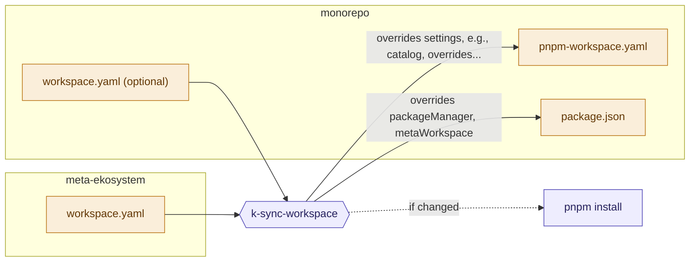
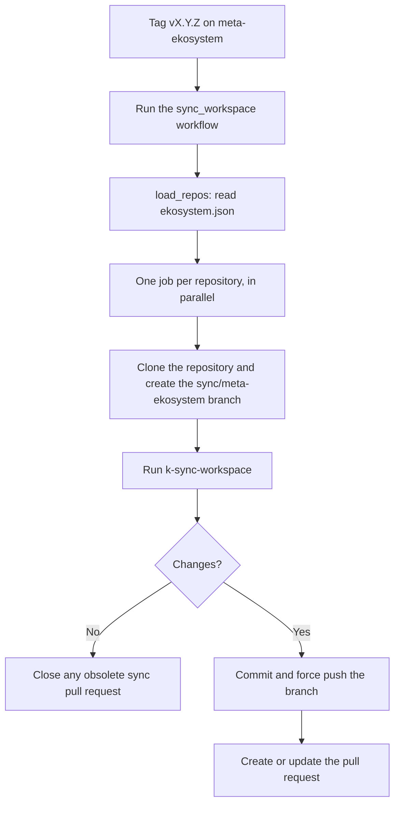

# meta-ekosystem

[](https://github.com/kalisio/meta-ekosystem/releases)
[](https://www.npmjs.com/package/@kalisio/meta-ekosystem)
[](https://opensource.org/licenses/MIT)


_Kalisio's meta-repo for sharing tools, configurations, and conventions_

---

This repository centralizes common development resources used across Kalisio projects, including:
- A meta package catalog for ecosystem management
- Various scripts to be included in monorepo projects that includes this meta-repo
- Various code generators to help creating monorepo projects
- Common conventions

> [!IMPORTANT]
> Before getting started, make sure you have the following prerequisites installed:
> - [Node.js](https://nodejs.org/) >= 20
> - [pnpm](https://pnpm.io/) >= 10

## Usage

### Installation

``` bash
git clone https://github.com/kalisio/meta-ekosystem
cd meta-ekosystem
pnpm install
pnpm link --global
```

### Resources

#### Workspace

The [`workspace.yaml`](./workspace.yaml) file, also referred to as the **meta-workspace**, centralizes the PNPM
workspace configuration shared across the **Kalisio** ecosystem: the dependency catalog with the respective versions,
overrides, and other PNPM settings, as well as the PNPM version to be used.

> [!TIP]
> Use the [k-sync-workspace](#k-sync-workspace) command to keep your monorepo synchronized with this meta-workspace.


### Commands

#### k-init-monorepo

##### Description

It generates a **monorepo** skeleton with the following structure:

```
monorepo
├── docs
│   ├── index.md
│   ├── overview
│   │   ├── about.md
│   │   ├── contact.md
│   │   ├── contributing.md
│   │   ├── license.md
│   │   └── roadmap.md
│   └── package.json
├── knip.json
├── LICENSE.md
├── lint-staged.config.mjs
├── package.json
├── pnpm-workspace.yaml
├── README.md
├── scripts
│   └── prepare.mjs
├── sonar-project.properties
├── vite.base-config.js
└── vitest.base-config.js
```

##### Usage

```bash
pnpm k-init-monorepo
```

> [!NOTE]
> You will be prompted for the repository `name` and `path`.

#### k-init-package

##### Description

It generates a **package** skeleton with the following structure:

- library

```
library
├── LICENSE.md
├── package.json
├── README.md
├── src
│   └── index.js
├── test
│   └── index.test.js
├── vite.config.js
└── vitest.config.js
```

- service

```
service
|_ .dockerignore
├── config
│   └── default.cjs
├── Dockerfile
├── LICENSE.md
├── package.json
├── README.md
├── src
│   ├── channels.js
│   ├── hooks.js
│   ├── main.js
│   ├── middlewares.js
│   ├── routes.js
│   └── server.js
├── test
│   └── healthcheck.test.js
└── vitest.config.js
```

- job

```
job
├── Dockerfile
├── jobfile.js
├── LICENSE.md
├── package.json
└── README.md
```

It adds the following scripts to the parent monorepo's `package.json`:

- library

| Script | Description |
|---|---|
| `build:<package>` | Build the library |
| `lint:<package>`  | Lint the library  |
| `test:<package>`  | Run the library tests |

- service

| Script | Description |
|---|---|
| `lint:<package>`  | Lint the service  |
| `test:<package>`  | Run the service tests |

- job

None.

The command also updates the documentation configuration accordingly:
- adds an entry to the `packages.json` file, which is used to generate the documentation
- creates a new folder in the packages directory containing an `index.md` file

##### Usage

> [!IMPORTANT]
> Run this command from the root directory of your monorepo.

```bash
cd path/to/<my-monorepo>
pnpm k-init-package
```

You will be prompted to enter the package `name` and `description`.

#### k-init-example

##### Description

It generates an **example** skeleton with the following structure:

```
example
├── LICENSE.md
├── package.json
├── README.md
└── vite.config.js
```

##### Usage

> [!IMPORTANT]
> Run this command from the root directory of your monorepo.

```bash
cd path/to/<my-monorepo>
pnpm k-init-example
```

You will be prompted to enter the example `name`.

#### k-sync-workspace

##### Description

It synchronizes your monorepo with the **meta-workspace**:

- merges the **meta-workspace** with an optional local `workspace.yaml` file, then writes the result
to `pnpm-workspace.yaml`. Maps (e.g. `catalog`, `overrides`) are merged with local entries taking precedence,
lists are merged, other values are taken from the local file. The `packages` setting is never modified.
- sets the `packageManager` field of the `package.json` according to the `pnpmVersion` defined in the **meta-workspace**.
- records the meta-workspace version and the synchronization date in the `metaWorkspace` field of the `package.json`.
- runs `pnpm install` if the workspace or the PNPM version has changed.



> [!TIP]
> Use a local `workspace.yaml` file to add dependencies specific to your monorepo or to override a meta-workspace
> version, rather than editing `pnpm-workspace.yaml` directly: it would be overwritten by the next synchronization.

##### Usage

> [!IMPORTANT]
> Run this command from the root directory of your monorepo.

```bash
cd path/to/<my-monorepo>
pnpm k-sync-workspace
```

## Contributing

### Guidelines

Found a bug ? Missing a feature ? Want to contribute ? Please refer to our [contribution guidelines](./docs/CONTRIBUTING.md)
for details.

### Linting

```bash
pnpm lint
```

> [!NOTE]
> This repository follows the [standardJS](https://standardjs.com/) style guide for linting and code consistency.
> By default, **standard** is called with the `--fix` option to automatically fix style issues before committing.

### Versioning

Create changesets as needed during the development phase using:

```bash
pnpm change
```

> [!NOTE]
> It is recommended to create a changeset for each significant commit, e.g., a fix or feat.

Then update the **version** using:

```bash
pnpm bump
```

### Publishing

To publish this package to [NPM](https://www.npmjs.com/), use:

```bash
pnpm release
```

> [!NOTE]
> When publishing a tag will be created corresponding to the **version** defined in the `package.json`

## CI/CD Workflow

When a version tag (e.g., `v1.2.3`) is pushed to this repository, a GitHub Actions workflow automatically:

1. **Discovers** all repositories defined in the `ekosystem.json` file.
2. **Clones** each discovered repository.
3. **Runs** `k-sync-workspace` inside each clone to update the dependencies according to the central `workspace.yaml`.
4. **Opens** a pull request for every repository that has changes, using a dedicated GitHub App bot (`meta-ekosystem-ci[bot]`):
   - the changes are committed on a single `sync/meta-ekosystem` branch, rebuilt from the default branch on every sync, so that pull requests don't pile up,
   - if a sync pull request is already open, it is updated instead of creating a new one,
   - if the repository is already up to date, any open sync pull request is obsolete and is closed,

This ensures that every dependent repository stays synchronized with the latest dependency versions defined in this **meta‑workspace**.

<details>
<summary>Click to see the diagram that illustrates this CI/CD workflow</summary>



</details>

> [!IMPORTANT]
> This workflow can also be triggered manually from GitHub Actions.

## License

Licensed under the [MIT License](LICENSE).

Copyright (c) 2026-present [Kalisio](https://kalisio.com)

<picture>
  <source media="(prefers-color-scheme: dark)" srcset="https://kalisio.github.io/kalisioscope/kalisio/kalisio-logo-dark.svg">
  <source media="(prefers-color-scheme: light)" srcset="https://kalisio.github.io/kalisioscope/kalisio/kalisio-logo-light.svg">
  
</picture>
